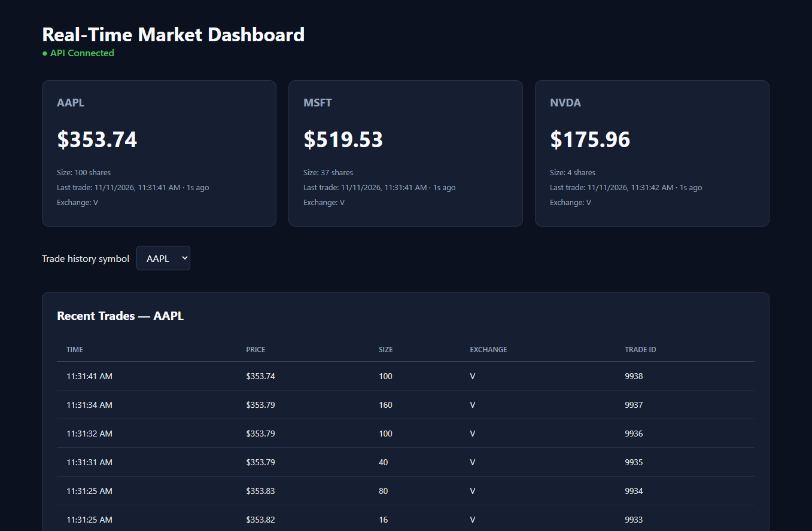
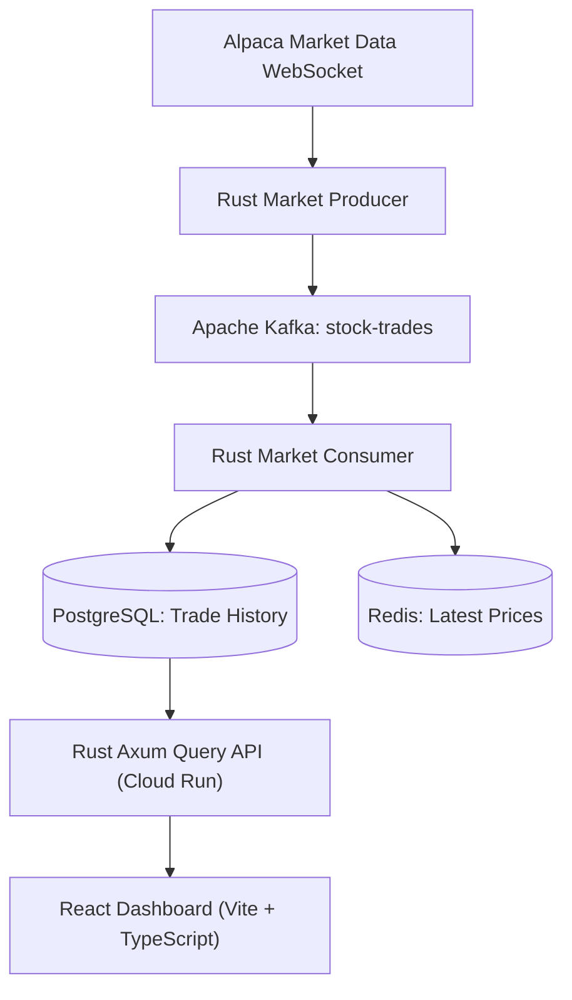
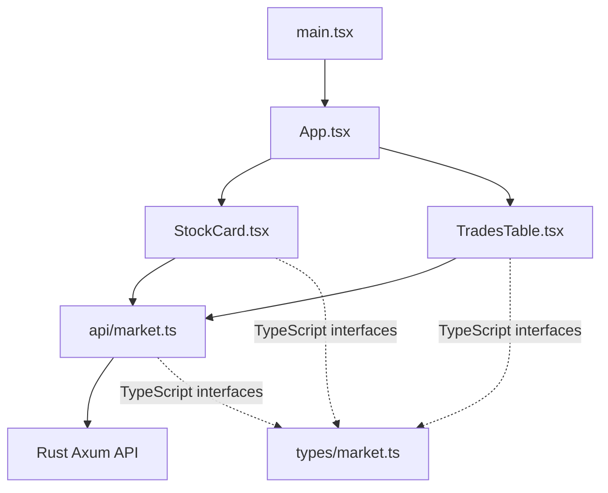
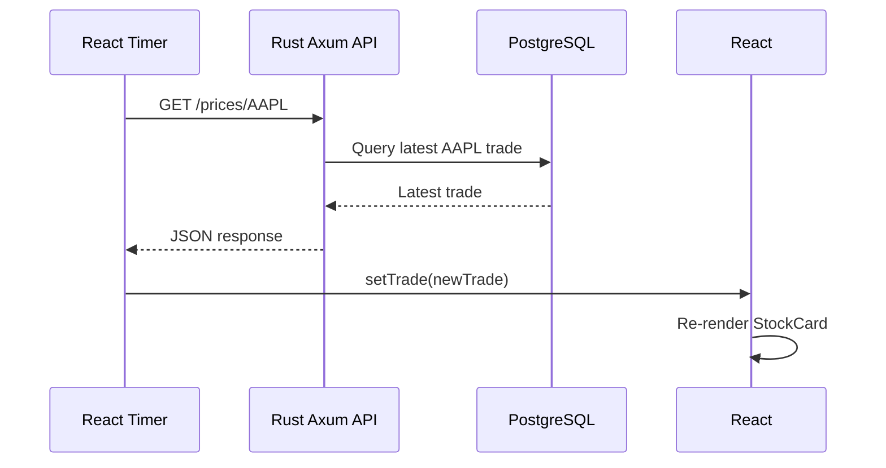

# Real-Time Market Pipeline Dashboard

A React and TypeScript dashboard displaying live stock prices and recent trades from a Rust-based market data pipeline. The query API runs on Google Cloud Run and reads from a hosted Neon PostgreSQL database.



The running dashboard shows:

- Latest prices, trade sizes, exchange codes, and trade timestamps for **AAPL**, **MSFT**, and **NVDA**.
- Selectable trade history with prices, sizes, exchange codes, and trade IDs.
- API connection status and automatic polling for updates.

Screenshot captured November 11, 2026.

## System Architecture



The consumer also maintains Redis latest-price entries. The current query API reads both latest prices and trade history from PostgreSQL; Redis is outside the dashboard query path. The deployed database is hosted on Neon.

### How Data Flows

1. **Alpaca** streams real-time market trades over a WebSocket connection.
2. **Rust Producer** receives the trades and publishes them to Kafka.
3. **Kafka** buffers the events for downstream processing.
4. **Rust Consumer** processes trades in batches, writing historical data to PostgreSQL and the latest prices to Redis.
5. **Axum Query API** exposes HTTP endpoints for retrieving prices and trade history.
6. **React Dashboard** periodically requests updated data and renders stock cards and recent trades.

### Dashboard Polling

- Latest stock prices: every **2 seconds**, from PostgreSQL through the API.
- Recent trades: every **5 seconds**, from PostgreSQL through the API.

The dashboard uses HTTP polling rather than a persistent WebSocket connection.

## Frontend File Map

| File | Purpose |
|---|---|
| `index.html` | HTML entry point. Provides the root element where React mounts the application. |
| `src/main.tsx` | Starts React and renders the `App` component. |
| `src/App.tsx` | Main dashboard layout. Creates the stock cards and recent trades table. |
| `src/App.css` | Dashboard styling, including cards, grid layout, and trade table. |
| `src/index.css` | Global styling, including fonts, background, and base CSS rules. |
| `src/components/StockCard.tsx` | Displays the latest price for one stock. Refreshes every 2 seconds. |
| `src/components/TradesTable.tsx` | Displays recent trades for one stock. Refreshes every 5 seconds. |
| `src/api/market.ts` | Makes HTTP requests to the Rust Axum API. |
| `src/types/market.ts` | Defines TypeScript interfaces for API responses. |
| `vite.config.ts` | Configures Vite and proxies `/api` requests to the local Rust API during development. |
| `package.json` | Defines project dependencies and npm commands. |
| `tsconfig.json` | TypeScript project configuration. |

### How the React Files Work Together



**Key distinction:** Components determine what appears on the screen. The API module handles data retrieval. TypeScript interfaces define the expected data structure.

Keeping these responsibilities separate makes the dashboard easier to extend and maintain.

## React State, Effects, and Polling

Our dashboard uses three important React concepts:

### 1. `useState` — Remember Data

`useState` allows a component to retain data between renders.

For example, `StockCard.tsx` stores the latest trade:

```tsx
const [trade, setTrade] = useState<LatestTrade | null>(null);
```

When new market data arrives, `setTrade()` updates the state and React renders the component again with the new price.

### 2. `useEffect` — Perform Background Work

`useEffect` runs code associated with a component's lifecycle.

We use it to start fetching market data when a component mounts.

```tsx
useEffect(() => {
  // Start fetching data
}, [symbol]);
```

The dependency array `[symbol]` tells React to rerun the effect if the stock symbol changes.

### 3. `setInterval` — Poll for Updates

Our stock cards periodically request fresh prices:

```tsx
useEffect(() => {
  const refresh = () => {
    getLatestTrade(symbol).then(setTrade).catch(console.error);
  };

  refresh();

  const interval = setInterval(refresh, 2000);

  return () => clearInterval(interval);
}, [symbol]);
```

This performs an immediate request and then repeats it every two seconds.

**Why cleanup matters:** `clearInterval()` stops the timer when the component unmounts or its symbol changes. Without cleanup, multiple timers could accumulate and generate unnecessary requests.

Our recent trades table uses the same approach with a five-second polling interval.

### How a Price Update Reaches the Screen



React updates the displayed price without reloading the entire web page.

## Run the Dashboard

Requires Node.js and npm. The backend lives in the separate [real-time-market-pipeline repository](https://github.com/tpcleary19/real-time-market-pipeline).

```bash
npm ci
```

### Connect to a Deployed API

Create `.env.local` in the dashboard directory:

```dotenv
VITE_API_BASE_URL=https://YOUR-CLOUD-RUN-SERVICE.run.app
```

Replace the example with your deployed API URL, without a trailing slash. Then start Vite:

```bash
npm run dev
```

Open **http://localhost:5173**. The API must allow that exact origin through `CORS_ALLOWED_ORIGINS`. An IP address, another port, or a hosted dashboard URL is a different origin and must be allowed separately. Restart Vite after changing environment files.

The dashboard needs only the API URL. Database credentials and Alpaca keys belong in the backend environment or Secret Manager. Vite variables prefixed with `VITE_` are visible to the browser.

### Connect to a Local API

Follow the backend repository instructions to configure Alpaca credentials, start Kafka/PostgreSQL/Redis, apply migrations, and run the producer and consumer. Configure `ALPACA_SYMBOLS=AAPL,MSFT,NVDA` for the dashboard's three symbols.

Start the query API from the backend directory:

```bash
cargo run -p query-api
```

The API defaults to port **3001** and reads `DATABASE_URL` from its environment or backend `.env` file. Ensure it uses the same database as the consumer.

Remove `VITE_API_BASE_URL` from dashboard environment files to use the default `/api` path, then restart Vite. The development proxy forwards requests as follows:

```text
Browser: http://localhost:5173/api/prices/AAPL
    → Vite development proxy
    → Rust API: http://localhost:3001/prices/AAPL
    → PostgreSQL
```

If the backend uses a different `PORT`, update the proxy target in `vite.config.ts` to match.

### API Endpoints

| Endpoint | Purpose |
|---|---|
| `GET /health` | API health check used by the connection indicator |
| `GET /ready` | Database readiness check |
| `GET /prices/AAPL` | Latest stored AAPL trade |
| `GET /trades/AAPL?limit=10` | Ten most recent AAPL trades |

Replace `AAPL` with `MSFT` or `NVDA` for the other dashboard symbols. The base `/` route is not defined and returns 404.

### Build and Check

```bash
npm run lint
npm run build
```

The production build is written to `dist/`. Set `VITE_API_BASE_URL` before building for static hosting; the Vite development proxy is available only during development. Allow the hosted frontend's exact origin in the API's CORS configuration.

Environment files, dependencies, and build output are excluded from Git. The screenshot is stored in `docs/images/` so GitHub renders it directly in this README.
