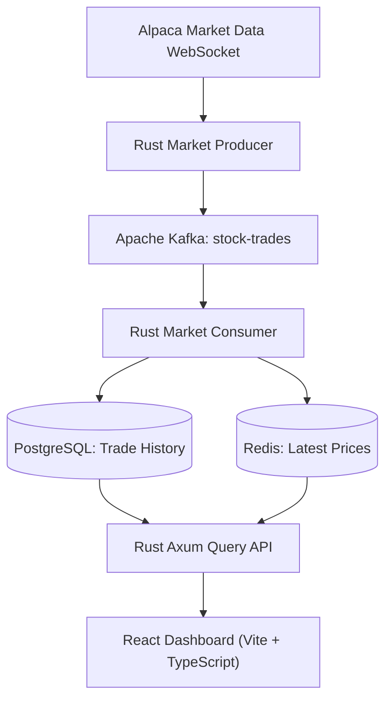
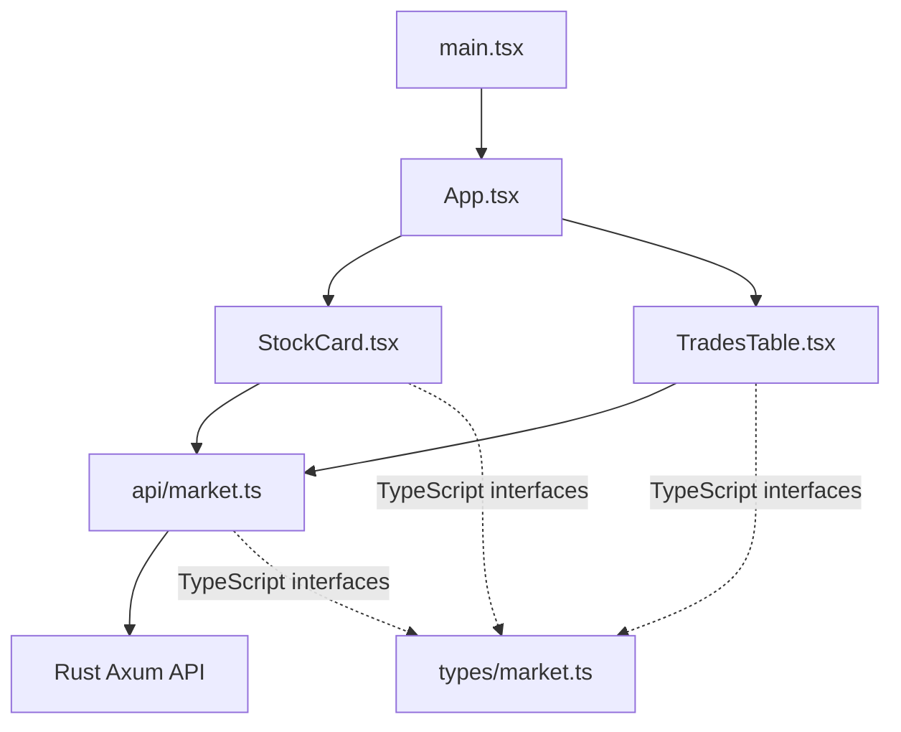
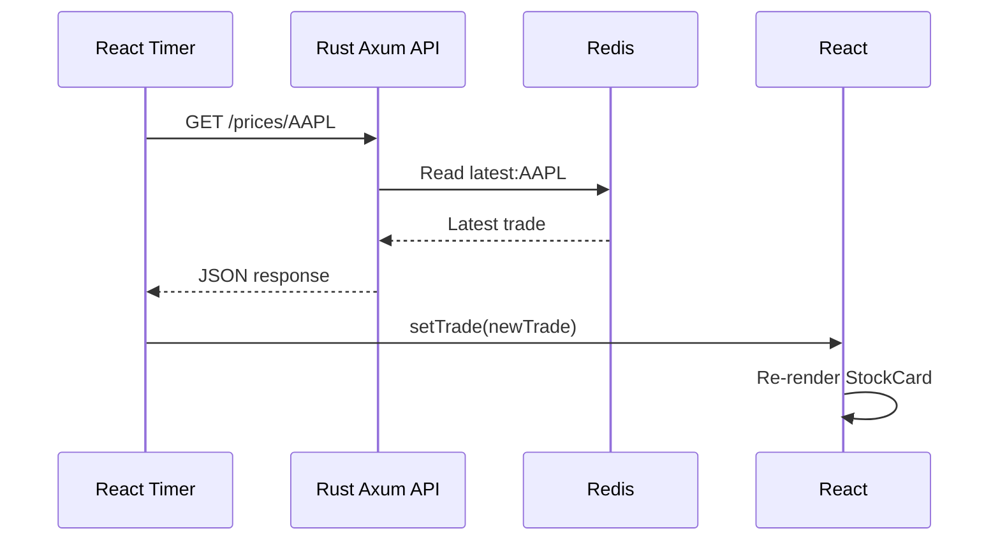

# Real-Time Market Pipeline Dashboard

A React and TypeScript dashboard displaying live stock prices and recent trades from a Rust-based market data pipeline.

## System Architecture



### How Data Flows

1. **Alpaca** streams real-time market trades over a WebSocket connection.
2. **Rust Producer** receives the trades and publishes them to Kafka.
3. **Kafka** buffers the events for downstream processing.
4. **Rust Consumer** processes trades in batches, writing historical data to PostgreSQL and the latest prices to Redis.
5. **Axum Query API** exposes HTTP endpoints for retrieving prices and trade history.
6. **React Dashboard** periodically requests updated data and renders stock cards and recent trades.

### Dashboard Polling

- Latest stock prices: every **2 seconds**, from Redis through the API.
- Recent trades: every **5 seconds**, from PostgreSQL through the API.

The dashboard uses HTTP polling rather than a persistent WebSocket connection.

## Frontend File Map

| File | Purpose |
|---|---|
| `index.html` | HTML entry point. Provides the root element where React mounts the application. |
| `src/main.tsx` | Starts React and renders the `App` component. |
| `src/App.tsx` | Main dashboard layout. Creates the stock cards and recent trades table. |
| `src/App.css` | Dashboard styling, including cards, grid layout, and trade table. |
| `src/index.css` | Global styling, including fonts, background, and base CSS rules. |
| `src/components/StockCard.tsx` | Displays the latest price for one stock. Refreshes every 2 seconds. |
| `src/components/TradesTable.tsx` | Displays recent trades for one stock. Refreshes every 5 seconds. |
| `src/api/market.ts` | Makes HTTP requests to the Rust Axum API. |
| `src/types/market.ts` | Defines TypeScript interfaces for API responses. |
| `vite.config.ts` | Configures Vite and proxies `/api` requests to the local Rust API during development. |
| `package.json` | Defines project dependencies and npm commands. |
| `tsconfig.json` | TypeScript project configuration. |

### How the React Files Work Together



**Key distinction:** Components determine what appears on the screen. The API module handles data retrieval. TypeScript interfaces define the expected data structure.

Keeping these responsibilities separate makes the dashboard easier to extend and maintain.

## React State, Effects, and Polling

Our dashboard uses three important React concepts:

### 1. `useState` — Remember Data

`useState` allows a component to retain data between renders.

For example, `StockCard.tsx` stores the latest trade:

```tsx
const [trade, setTrade] = useState<LatestTrade | null>(null);
```

When new market data arrives, `setTrade()` updates the state and React renders the component again with the new price.

### 2. `useEffect` — Perform Background Work

`useEffect` runs code associated with a component's lifecycle.

We use it to start fetching market data when a component mounts.

```tsx
useEffect(() => {
  // Start fetching data
}, [symbol]);
```

The dependency array `[symbol]` tells React to rerun the effect if the stock symbol changes.

### 3. `setInterval` — Poll for Updates

Our stock cards periodically request fresh prices:

```tsx
useEffect(() => {
  const refresh = () => {
    getLatestTrade(symbol).then(setTrade).catch(console.error);
  };

  refresh();

  const interval = setInterval(refresh, 2000);

  return () => clearInterval(interval);
}, [symbol]);
```

This performs an immediate request and then repeats it every two seconds.

**Why cleanup matters:** `clearInterval()` stops the timer when the component unmounts or its symbol changes. Without cleanup, multiple timers could accumulate and generate unnecessary requests.

Our recent trades table uses the same approach with a five-second polling interval.

### How a Price Update Reaches the Screen



React updates the displayed price without reloading the entire web page.

## Local Development

The dashboard and Rust backend are maintained in separate repositories.

### Prerequisites

- Node.js and npm
- Rust backend running locally
- PostgreSQL, Redis, and Kafka running through Docker Compose

### Start the Backend

From `~/real-time-market-pipeline`:

```bash
docker compose up -d
cargo run -p query-api
```

To ingest live market data, also start the consumer and producer in separate terminals:

```bash
cargo run -p market-consumer
```

```bash
ALPACA_SYMBOLS=AAPL cargo run -p market-producer
```

The producer requires valid Alpaca API credentials.

### Start the Dashboard

From `~/market-pipeline-dashboard`:

```bash
npm install
npm run dev
```

Open `http://localhost:5173/`.

### API Endpoints

| Endpoint | Purpose | Data Source |
|---|---|---|
| `GET /health` | Backend health check | Axum |
| `GET /prices/AAPL` | Latest trade for AAPL | Redis, with PostgreSQL fallback |
| `GET /trades/AAPL?limit=10` | Ten most recent AAPL trades | PostgreSQL |

### Development Proxy

During local development, Vite forwards requests beginning with `/api` to the Rust backend at `http://localhost:3000`.

For example:

```text
Browser: GET http://localhost:5173/api/prices/AAPL
                    |
                    v
Vite proxy: GET http://localhost:3000/prices/AAPL
                    |
                    v
Rust Axum API
```

This allows the frontend to call the backend without hardcoding a separate local API address in every component.

For deployment, the frontend can use `VITE_API_BASE_URL` to specify the publicly reachable API address.

## Git Workflow

After making changes:

```bash
git status
git add .
git commit -m "Describe the changes"
git push
```

The frontend and backend have separate Git repositories and are committed independently.